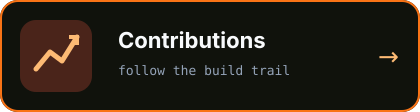
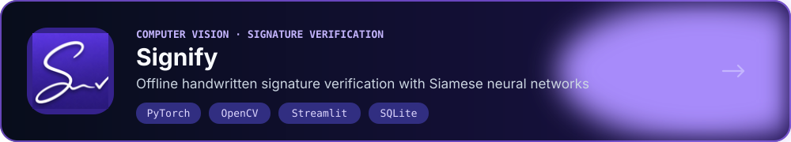
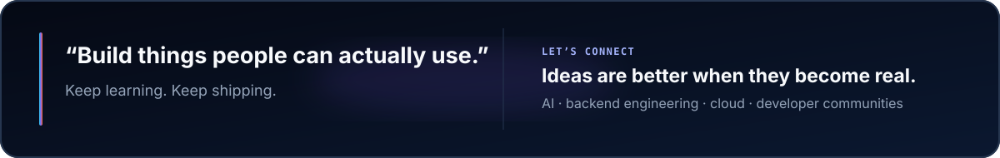
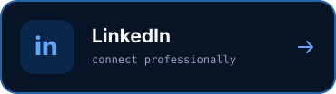
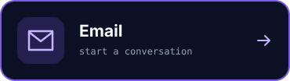
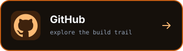

  

<table align="center" width="100%">
<tr>
<td width="64%" valign="top">
  
</td>
<td width="36%" valign="middle">
  
   
  
   
  
</td>
</tr>
</table>

<picture>
  <source media="(prefers-color-scheme: dark)" srcset="https://raw.githubusercontent.com/IlkeOzcendek/IlkeOzcendek/output/github-contribution-grid-snake-dark.svg" />
  <source media="(prefers-color-scheme: light)" srcset="https://raw.githubusercontent.com/IlkeOzcendek/IlkeOzcendek/output/github-contribution-grid-snake.svg" />
  
</picture>

  
  
  

